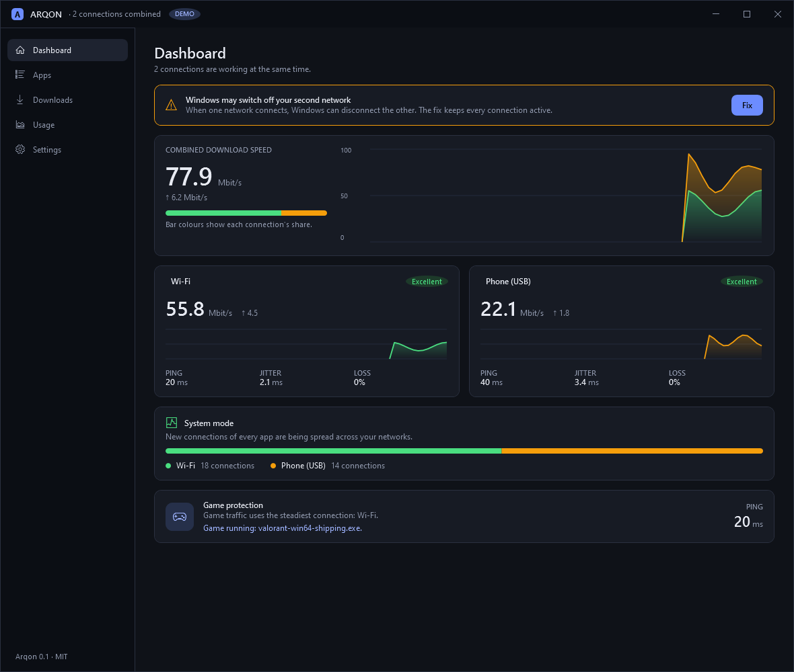
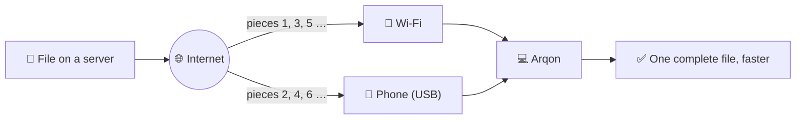
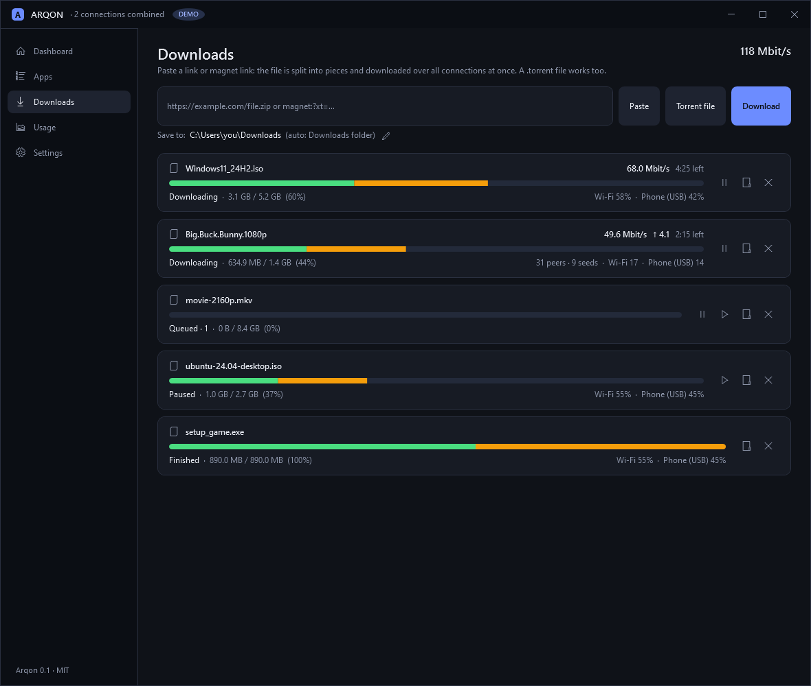
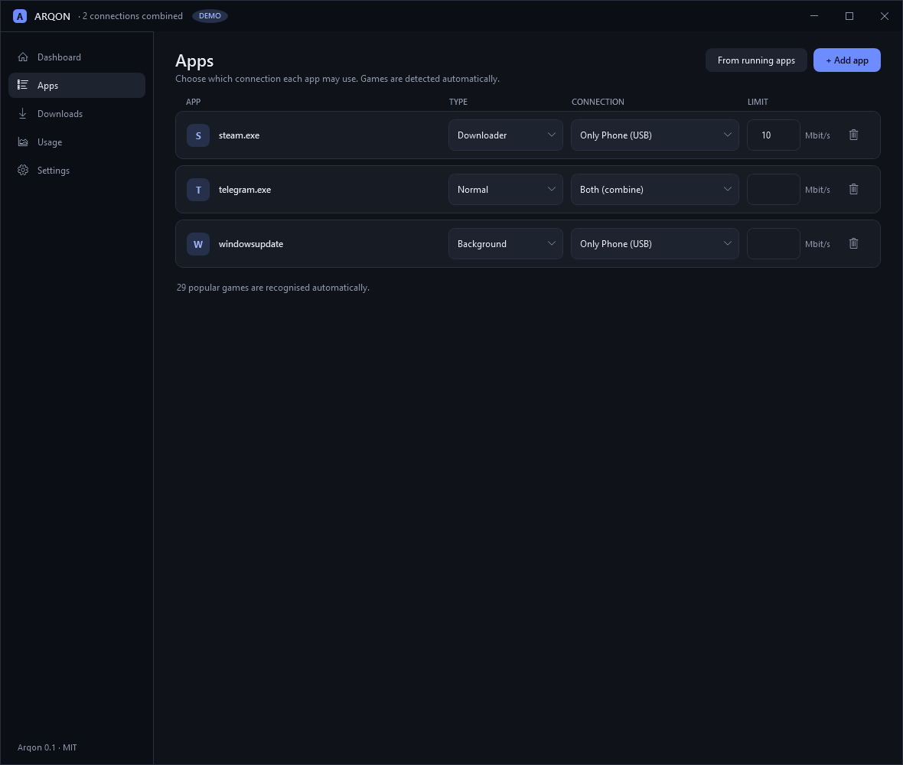
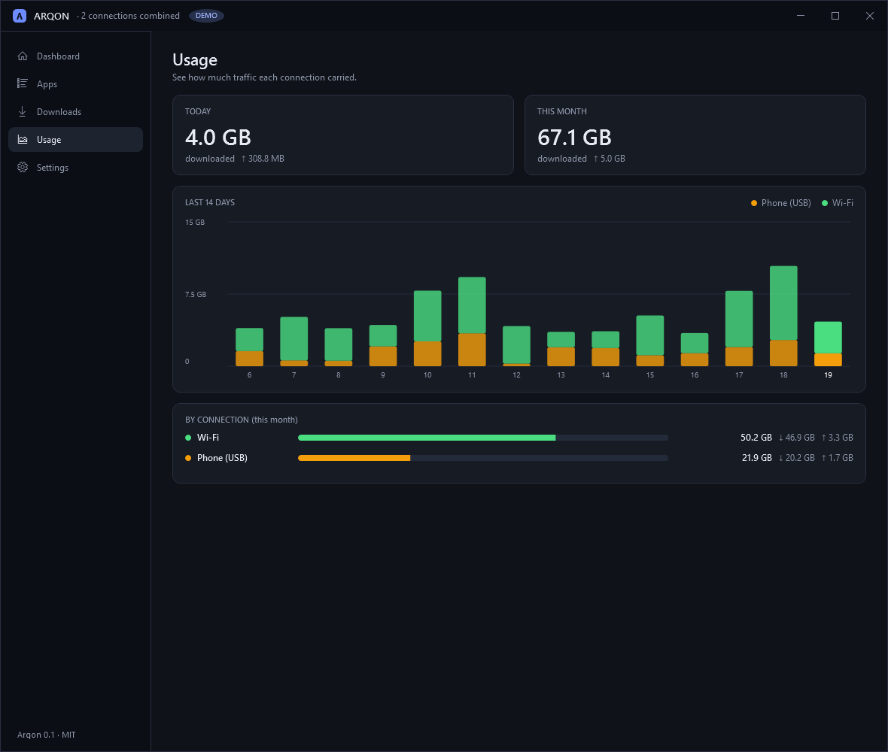

<div align="center">


# Arqon

### Wi-Fi + Ethernet + your phone's internet, all at once, on Windows.

**⚡ Faster downloads &nbsp;·&nbsp; 🎮 Smooth games while you download &nbsp;·&nbsp; 🆓 Free &nbsp;·&nbsp; 🔓 Open source**

[](https://github.com/shaxboz1011/Arqon/releases/latest)

[](https://github.com/shaxboz1011/Arqon/actions/workflows/build.yml)
[](https://github.com/shaxboz1011/Arqon/releases/latest)
[](https://github.com/shaxboz1011/Arqon/releases)
[](LICENSE)


**🌐 Language:** **English** · [O'zbekcha](README.uz.md) · [Русский](README.ru.md)

<br>



</div>

<br>

> *Arqon* means "rope" in Uzbek: several thin strands, one strong line.

**On this page:**
[Why](#-why-arqon) ·
[How it works](#-how-it-works) ·
[Install](#-install-in-1-minute) ·
[Tour](#-quick-tour) ·
[System mode](#-system-mode-every-app) ·
[Command line](#-command-line) ·
[FAQ](#-faq) ·
[Build](#-build-from-source) ·
[Status](#-features-and-status) ·
[Contribute](#-contributing)

---

## 🎯 Why Arqon

Most people have more than one way online: home Wi-Fi, a cable, a phone with a data plan. **Windows uses only one at a time.** So a big download crawls, and while it runs your game lags.

Arqon puts **all of them to work together**:

| | What you get | Proof |
|---|---|---|
| ⚡ | **Faster downloads.** A file is cut into pieces and every piece travels over a different connection at the same time. | 140 MB over Wi-Fi + a USB phone in about **10 s** |
| 🎮 | **Games stay smooth.** Arqon notices a running game, watches its ping, and slows downloads *only on the game's link*, *only as much as needed*, then gives the speed back. | Game guard with automatic recovery |
| 🌍 | **Every app can benefit.** *System mode* spreads the connections of Telegram, Chrome, Steam and others over your links. | 40 parallel downloads in **5.3 s** instead of 11.3 s |
| 🧲 | **Torrents too.** Peer connections are spread over every link. Paste a magnet link or open a `.torrent`, and pick which files you want. | Real Debian torrent: both adapters carried data |
| 🔒 | **Nothing hidden.** No account, no ads, no tracking. | MIT licence, read the code |

> [!IMPORTANT]
> Arqon adds bandwidth only when each link has its **own** way to the internet, for example Wi-Fi from one router plus a phone's mobile data. Two adapters behind the *same* router share one line and give no gain.

## 🧵 How it works



- **Downloads and torrents:** Arqon opens connections bound to each adapter and shares the pieces between them. A slow or dead link never blocks the others.
- **Game guard:** it watches ping, jitter and loss of the link a game uses. When they rise, downloads on that link are slowed a little; when they calm down, the speed comes back step by step.
- **System mode (optional):** a packet driver lets Arqon give each *new* connection of any program to one of your links. A connection never moves once started, so nothing breaks.

## 📸 Screenshots

<div align="center">

| Downloads | Apps | Usage |
|:---:|:---:|:---:|
|  |  |  |

</div>

<sub>The interface is in **Uzbek, English and Russian** (switch in Settings, it changes at once). This guide is in the same three languages. Screenshots are taken in demo mode.</sub>

## 🚀 Install in 1 minute

1. **Download `Arqon.exe`** from the [latest release](https://github.com/shaxboz1011/Arqon/releases/latest). It is one file: nothing to install, .NET is included.
2. **Double-click it.**

   > [!NOTE]
   > Windows SmartScreen may say the app is unrecognised, because the file is not code-signed yet (see [Security](#-security)). Click **More info → Run anyway**.

3. **Connect your second internet**, for example a phone with **USB tethering**.
   *Android: Settings → Network → Hotspot & tethering → USB tethering.*
4. **Open Dashboard.** Both connections should be listed. If a yellow notice appears, press **Fix** (otherwise Windows may switch off the second network).

<details>
<summary><b>📦 With winget</b></summary>

```powershell
winget install shaxboz1011.Arqon
```

The package is submitted with each release and becomes available once Microsoft accepts it. Details: [docs/winget.md](docs/winget.md).

</details>

<details>
<summary><b>🔐 Verify the download (optional)</b></summary>

Compare the SHA-256 of your file with the `Arqon.exe.sha256` file in the release:

```powershell
(Get-FileHash .\Arqon.exe -Algorithm SHA256).Hash
```

</details>

## 🧭 Quick tour

| Page | What you do there |
|---|---|
| 📊 **Dashboard** | See every connection live: speed, ping, jitter, loss. One-click fix for Windows switching off the second network. |
| ⬇️ **Downloads** | Paste a file link or a magnet link, or pick a `.torrent`. Choose the folder. Pick files inside a multi-file torrent. |
| 🧩 **Apps** | Rules per app: automatic, only Wi-Fi, only phone, both, or a speed cap. Games are detected automatically. |
| 📈 **Usage** | How much data each connection used per day and month (handy for a phone data plan). |
| ⚙️ **Settings** | Language, speed unit (Mbit/s or MB/s), game protection, system mode, torrents, tray, start with Windows. |

## 🔧 System mode (every app)

System mode steers new connections of **all** programs over your links. It needs the signed [WinDivert](https://reqrypt.org/windivert.html) packet driver and **administrator rights**, so it is **off by default**.

**The easy way:** *Settings → System mode → Set up system mode*. Windows asks for administrator rights once; then Arqon tells Windows Defender to leave its driver folder alone, downloads the official WinDivert 2.2.2 driver, checks that it is exactly the genuine file with a valid signature, and turns system mode on. (Windows Defender wrongly reports this packet driver as suspicious, e.g. `Misleading:Win32/Malgent`, and removes it. That is the usual reason system mode "does not work" on another computer. If you use another antivirus, allow the folder `%APPDATA%\Arqon\driver` in it.)

<details>
<summary><b>Or set it up by hand</b></summary>

```powershell
# 1. Download the helper script (it checks the driver's signature before installing)
Invoke-WebRequest https://raw.githubusercontent.com/shaxboz1011/Arqon/main/tools/get-windivert.ps1 -OutFile get-windivert.ps1

# 2. Put the driver next to Arqon.exe (change the folder to where your Arqon.exe is)
powershell -ExecutionPolicy Bypass -File .\get-windivert.ps1 -Destination "C:\Tools\Arqon"
```

Then start `Arqon.exe` **as administrator** and switch on *System mode* in Settings.

</details>

> [!TIP]
> It fails open: if anything goes wrong, Windows routes normally again at once. While a game from the catalogue runs, Arqon switches system mode off and unloads the driver (anti-cheat safety). Details: [docs/steering.md](docs/steering.md).

## 🧰 Command line

Everything is in the window, but these options exist:

| Command | What it does |
|---|---|
| `Arqon.exe` | Start normally. |
| `Arqon.exe "C:\path\file.torrent"` | Add a torrent file (what a double-click on a `.torrent` does). |
| `Arqon.exe "magnet:?xt=urn:btih:..."` | Add a magnet link. A running Arqon receives it and adds it. |
| `Arqon.exe --tray` | Start hidden in the tray (used by *Start with Windows*). |
| `Arqon.exe --demo` | Two pretend connections, no phone needed. Good for trying the interface. |
| `Arqon.exe --screenshots <folder>` | Save a picture of every page into the folder. |

In Settings, **Open torrents and magnet links with Arqon** registers it for `.torrent` files and `magnet:` links (current user only, no administrator rights, and it never takes over another program's default).

## 📱 Android (preview)

The [`android/`](android/README.md) folder holds an Android app, written in Kotlin, that does for a phone what Arqon does on Windows: it asks Android for Wi-Fi and for each SIM card at the same time and spreads downloads, torrents and browser downloads over all of them. It also has:

- a **browser that shows websites as a computer does** (some sites hide download links from phones),
- a **game mode**: the games you choose go over the best connection while Arqon's downloads keep off it,
- a **speed test**: each connection alone, all together, and the measured gain,
- **data usage** (today, this month, per app), a **speed meter** in the notification, a daily limit, and shortcuts to the phone's 5G / 4G network-mode screen.

It is a preview and there is no release yet. Whether the second SIM can carry data next to the first depends on the phone (many phones allow only one SIM for data at a time); the app shows exactly what Android gives it.

## ❓ FAQ

<details>
<summary><b>Do I need a phone?</b></summary>

No. Any two (or more) connections that have their own way to the internet work: Wi-Fi from one router plus a cable from another, plus a phone, and so on. A phone over USB tethering is just the easiest second line.

</details>

<details>
<summary><b>Will it eat my mobile data?</b></summary>

Yes, whatever goes through the phone is counted by your mobile plan. It is best with an unlimited plan. The **Usage** page shows what each link used, and **Apps** lets you pin an app to Wi-Fi only or set a speed cap.

</details>

<details>
<summary><b>Is it safe to use with online games?</b></summary>

Game protection only *slows downloads*; it does not touch the game. System mode loads a network driver, which some anti-cheat programs distrust, so **Safe game mode** (on by default) switches system mode off and unloads the driver while a game runs. It was tested with a fake game, **not yet with a real anti-cheat**. For VAC-protected games, keep system mode off if you want to be extra careful.

</details>

<details>
<summary><b>Why does system mode need administrator rights?</b></summary>

Only system mode does, because it loads a packet driver. Downloads, torrents, the game guard and everything else work without administrator rights.

</details>

<details>
<summary><b>Does it work on Windows 7, Linux or macOS?</b></summary>

No. Arqon is for Windows 10 and 11 (64-bit).

</details>

<details>
<summary><b>How do I remove it?</b></summary>

Turn off *Start with Windows* and *Open torrents and magnet links with Arqon* in Settings, close Arqon, and delete `Arqon.exe`. Its data (settings, download list) lives in `%APPDATA%\Arqon`; delete that folder too if you want. If you installed WinDivert for system mode, delete `WinDivert.dll` and `WinDivert64.sys` next to the exe.

</details>

## 📦 Build from source

You need Windows 10/11 and the [.NET 10 SDK](https://dotnet.microsoft.com/download).

```powershell
git clone https://github.com/shaxboz1011/Arqon.git
cd Arqon

dotnet run --project src/Arqon.App            # run with your real adapters
dotnet run --project src/Arqon.App -- --demo  # run with two pretend connections
dotnet test                                    # 620 tests

# one self-contained Arqon.exe (about 75 MB) in publish\win-x64
powershell -ExecutionPolicy Bypass -File tools\build.ps1
```

## 📋 Features and status

| Feature | Status |
|---|---|
| Link discovery (Wi-Fi / Ethernet / phone) and live monitor: speed, ping, jitter, loss | ✅ Done |
| Multi-link download manager: chunked HTTP ranges over every link, resume, endgame racing, speed limit, respects 429 / Retry-After | ✅ Done |
| Download queue (at most N at once, "Start now" jumps the line) | ✅ Done |
| Game ping guard: caps downloads on the game's link only, then gives bandwidth back gradually | ✅ Done |
| Per-app rules, built-in game catalogue, JSON settings | ✅ Done |
| One-click fix for the Windows policy that switches off the second network | ✅ Done |
| Usage statistics per link, per day and month | ✅ Done |
| Tray icon, notifications, clipboard offer, single instance, start with Windows | ✅ Done |
| Taskbar speed meter with hover totals | ✅ Done (tested on Windows 10, bottom taskbar) |
| Safe game mode (system mode off and driver unloaded while a game runs) | ✅ Done (tested with a fake game, not a real anti-cheat) |
| Speed unit switch (Mbit/s or MB/s) | ✅ Done |
| Speed test: each connection alone, all together, and the measured gain | ✅ Done |
| Update check (GitHub, can be switched off), daily data limit warning, usage export to CSV | ✅ Done |
| **Android app** (Wi-Fi + SIM cards where the phone allows it, torrents, desktop-mode browser, game mode, data usage and speed meter) | 🧪 Preview in [`android/`](android/README.md): tested on two phones, no release yet |
| Interface in Uzbek, English and Russian | ✅ Done (more languages welcome) |
| Torrents and magnet links over every link; choose folder; choose files; optional seeding with a share ratio, also after a restart; open from Windows | ✅ Done (real Debian torrent over Wi-Fi + phone) |
| **System mode** (speed up Telegram, Chrome, every app) | 🧪 Works in a first real test (Wi-Fi + USB phone). Not yet tested with a game or over a long session |
| Problem report to copy from Settings (crash log, connections, no personal data) | ✅ Done |
| winget package (manifests with every release) | ✅ Done (accepted into winget once submitted) |
| Browser extension for Chrome, Edge and Firefox (*Download with Arqon*), `arqon://` links | 🧪 In [`browser-extension/`](browser-extension/README.md), not in the stores yet |
| Download schedule, "save data" connections, daily-limit phone saver | ✅ Done |
| Local API for scripts ([docs/api.md](docs/api.md)) | ✅ Done |
| HLS videos (`.m3u8`) over every link, SHA-256 check of finished files | ✅ Done |
| Network check on the dashboard (sign-in pages, dead links, two links on one line, DNS) | ✅ Done |
| Relay server (one connection split across links, duplicated game packets) | 🧪 Groundwork: protocol pieces with tests ([docs/relay.md](docs/relay.md)) |
| Installer and code signing | 🗓 Planned |

Plans: [ROADMAP.md](ROADMAP.md).

What comes next: [ROADMAP.md](ROADMAP.md).

**Honest limits:** seeding is optional (off by default) and restarts after a restart only while the files are still on disk, UPnP port mapping is off unless switched on in Settings, and system mode has not yet been checked with the driver when running from the single-file `Arqon.exe`.

## 🔒 Security

- **No telemetry, no account.** Arqon connects only to what you ask for, plus: the link monitor opens a connection to `1.1.1.1` / `8.8.8.8` (port 443) to measure ping, torrents contact public trackers and the DHT, as every torrent client does, and twice a day it asks GitHub whether a newer version exists (switch it off in Settings). The Android app can send one small anonymous usage report a day, but only if you allow it, and the open-source build has no server to send it to. Details: [docs/privacy.md](docs/privacy.md).
- Changes to Windows (registry, driver) are explained first and reversible. System mode is off by default and fails open.
- `Arqon.exe` is **not code-signed yet**, so SmartScreen warns. Verify the SHA-256 or build it yourself from this source. Free code signing for open-source projects is planned.
- Found a vulnerability? Please read [SECURITY.md](SECURITY.md).

## 🆚 Compared with similar tools

[Plexo](https://github.com/anmolkapil/plexo) speeds up its own downloads (and torrents) with ranged requests over several networks. Arqon uses the same idea for its downloader and goes further: protecting game latency, per-app rules, steering the connections of other programs, and handling the Windows pitfalls (the Connection Manager policy) for you.

## 🤝 Contributing

Bug reports, ideas, translations and pull requests are welcome. Start with [CONTRIBUTING.md](CONTRIBUTING.md).

- 🧪 **Try it on your own two connections** and tell us the result: [share a test result](https://github.com/shaxboz1011/Arqon/issues/new/choose).
- 🌐 **Add a language** to the interface: copy `src/Arqon.App/Resources/Strings.en.xaml`, translate it, and a test checks that no text is missing.
- 🐛 **Report a bug** or suggest an idea in an [issue](https://github.com/shaxboz1011/Arqon/issues/new/choose).

If Arqon is useful to you, a ⭐ on GitHub helps other people find it.

## 📄 Licence

MIT, see [LICENSE](LICENSE). System mode uses [WinDivert](https://github.com/basil00/WinDivert) (LGPLv3), which is downloaded separately and is not part of this repository. Torrents use [MonoTorrent](https://github.com/alanmcgovern/monotorrent) (MIT).
