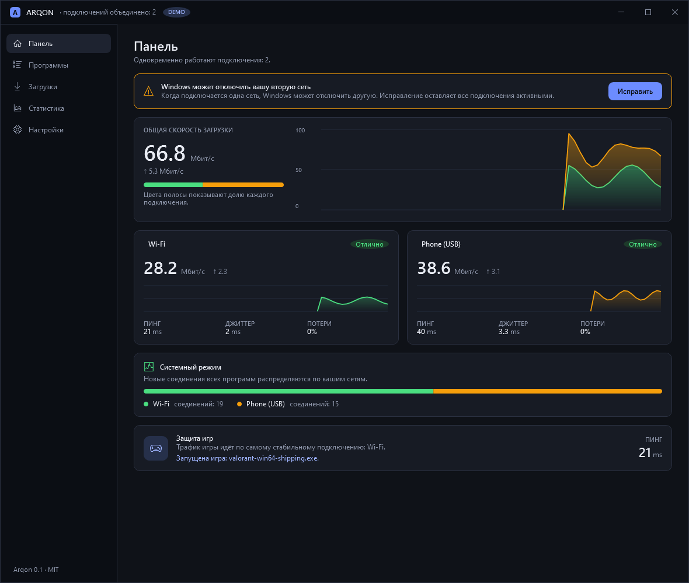
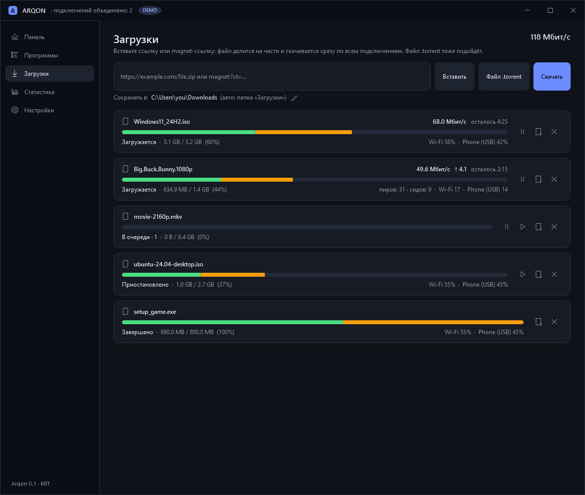
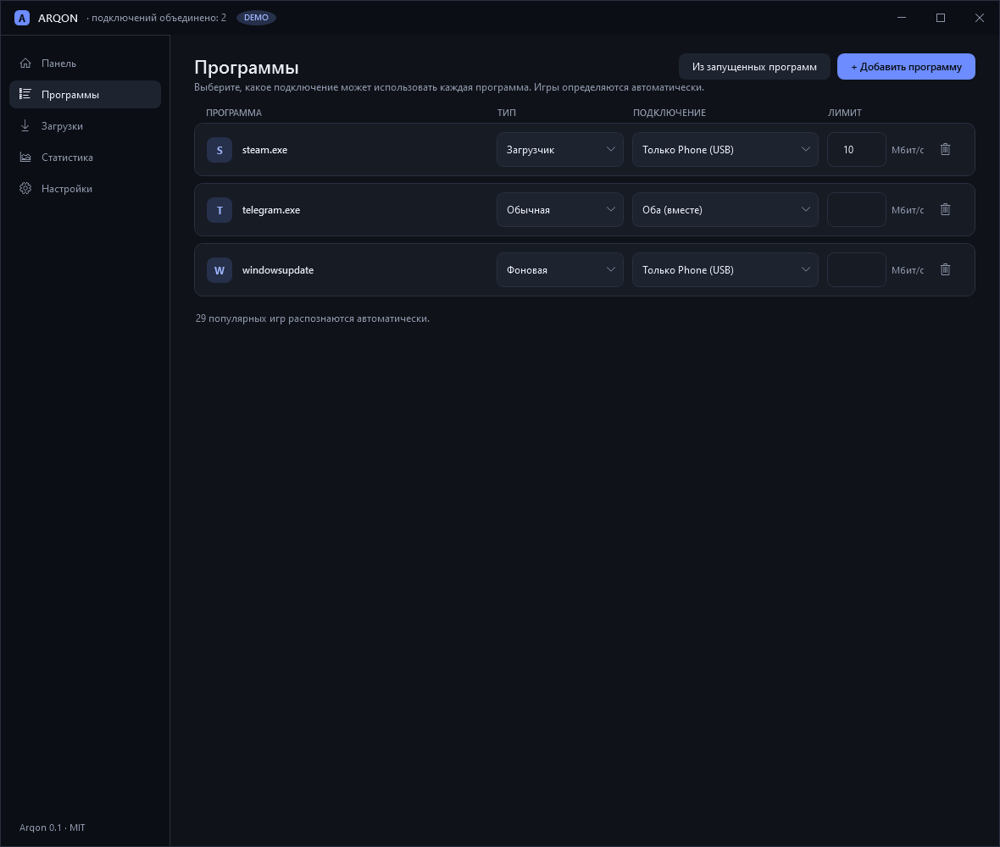
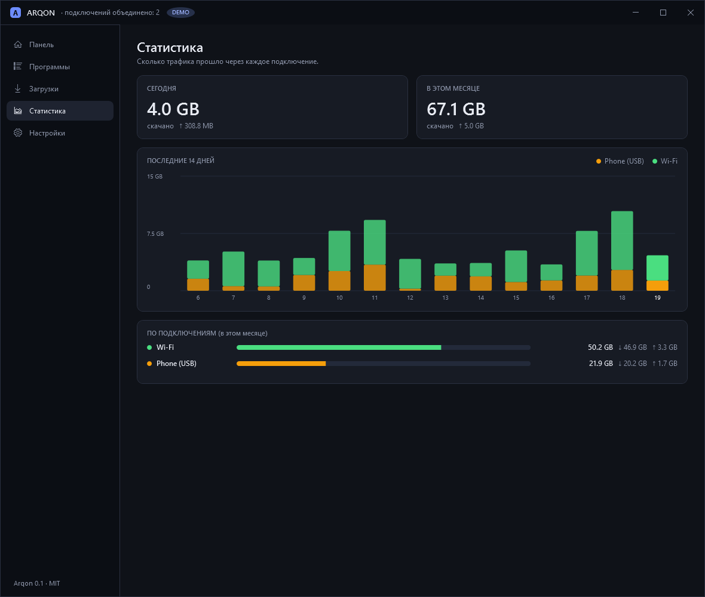

<div align="center">


# Arqon

### Wi-Fi + Ethernet + интернет с телефона, всё сразу, в Windows.

**⚡ Быстрее загрузки &nbsp;·&nbsp; 🎮 Игры не лагают во время загрузки &nbsp;·&nbsp; 🆓 Бесплатно &nbsp;·&nbsp; 🔓 Открытый код**

[](https://github.com/shaxboz1011/Arqon/releases/latest)

[](https://github.com/shaxboz1011/Arqon/actions/workflows/build.yml)
[](https://github.com/shaxboz1011/Arqon/releases/latest)
[](https://github.com/shaxboz1011/Arqon/releases)
[](LICENSE)


**🌐 Язык:** [English](README.md) · [O'zbekcha](README.uz.md) · **Русский**

<br>



</div>

<br>

> *Arqon* по-узбекски значит «верёвка»: несколько тонких нитей, один прочный канат.

**На этой странице:**
[Зачем](#-зачем-нужен-arqon) ·
[Как это работает](#-как-это-работает) ·
[Установка](#-установка-за-1-минуту) ·
[Обзор](#-краткий-обзор) ·
[Системный режим](#-системный-режим-для-всех-программ) ·
[Командная строка](#-командная-строка) ·
[Вопросы](#-вопросы-и-ответы) ·
[Сборка](#-сборка-из-исходников) ·
[Статус](#-возможности-и-статус) ·
[Помощь проекту](#-как-помочь-проекту)

---

## 🎯 Зачем нужен Arqon

У большинства есть несколько способов выйти в сеть: домашний Wi-Fi, кабель, мобильный интернет на телефоне. **Windows использует только один из них.** Поэтому большой файл качается медленно, а игра во время загрузки лагает.

Arqon **заставляет работать все подключения вместе**:

| | Что вы получаете | Подтверждение |
|---|---|---|
| ⚡ | **Быстрее загрузки.** Файл делится на части, и каждая часть скачивается по своему подключению одновременно. | 140 МБ по Wi-Fi + USB-телефону примерно за **10 с** |
| 🎮 | **Игра не лагает.** Arqon замечает запущенную игру, следит за её пингом и замедляет загрузки *только на подключении игры* и *только настолько, насколько нужно*. Потом возвращает скорость. | Защита игр с автоматическим восстановлением |
| 🌍 | **Выигрывают все программы.** *Системный режим* распределяет соединения Telegram, Chrome, Steam и других по вашим подключениям. | 40 параллельных загрузок за **5,3 с** вместо 11,3 с |
| 🧲 | **Торренты тоже.** Соединения с пирами распределяются по всем подключениям. Вставьте magnet-ссылку или откройте `.torrent` и выберите нужные файлы. | Настоящий торрент Debian: оба адаптера передавали данные |
| 🔒 | **Ничего скрытого.** Без аккаунта, без рекламы, без телеметрии. | Лицензия MIT, код открыт |

> [!IMPORTANT]
> Arqon прибавляет скорость только тогда, когда у каждого подключения **свой** выход в интернет: например, Wi-Fi от одного роутера и мобильный интернет телефона. Два адаптера за *одним* роутером делят одну линию, и выигрыша нет.

## 🧵 Как это работает


- **Загрузки и торренты:** Arqon открывает соединения, привязанные к каждому адаптеру, и делит части между ними. Медленное или «мёртвое» подключение не задерживает остальные.
- **Защита игр:** следит за пингом, джиттером и потерями подключения, которое использует игра. Когда они растут, загрузки на нём немного замедляются; когда всё спокойно, скорость возвращается ступенями.
- **Системный режим (по желанию):** пакетный драйвер позволяет Arqon отдавать каждое *новое* соединение любой программы одному из ваших подключений. Начатое соединение никогда не переносится, поэтому ничего не рвётся.

## 📸 Скриншоты

<div align="center">

| Загрузки | Приложения | Статистика |
|:---:|:---:|:---:|
|  |  |  |

</div>

<sub>Интерфейс программы на **узбекском, английском и русском** (переключается в настройках, меняется сразу). Скриншоты сделаны в демо-режиме.</sub>

## 🚀 Установка за 1 минуту

1. **Скачайте `Arqon.exe`** из [последнего релиза](https://github.com/shaxboz1011/Arqon/releases/latest). Это один файл: ничего устанавливать не нужно, .NET уже внутри.
2. **Запустите двойным щелчком.**

   > [!NOTE]
   > Windows SmartScreen может предупредить о неизвестном приложении, потому что файл пока не подписан ([Безопасность](#-безопасность)). Нажмите **Подробнее → Выполнить в любом случае**.

3. **Подключите второй интернет**, например телефон в режиме **USB-модема**.
   *Android: Настройки → Сеть → Точка доступа и модем → USB-модем.*
4. **Откройте Dashboard.** Оба подключения должны быть в списке. Если появилась жёлтая подсказка, нажмите **Fix** (иначе Windows может отключить вторую сеть).

<details>
<summary><b>🔐 Проверить скачанный файл (по желанию)</b></summary>

Сравните SHA-256 вашего файла с файлом `Arqon.exe.sha256` в релизе:

```powershell
(Get-FileHash .\Arqon.exe -Algorithm SHA256).Hash
```

</details>

## 🧭 Краткий обзор

| Страница | Что делать |
|---|---|
| 📊 **Dashboard** | Смотреть каждое подключение в реальном времени: скорость, пинг, джиттер, потери. Исправление «Windows отключает вторую сеть» одной кнопкой. |
| ⬇️ **Downloads** | Вставить ссылку на файл или magnet-ссылку либо выбрать `.torrent`. Выбрать папку. Выбрать файлы внутри торрента. |
| 🧩 **Apps** | Правила для каждой программы: автоматически, только Wi-Fi, только телефон, оба или лимит скорости. Игры определяются сами. |
| 📈 **Usage** | Сколько данных потратило каждое подключение за день и за месяц (удобно для тарифа телефона). |
| ⚙️ **Settings** | Язык, единица скорости (Мбит/с или МБ/с), защита игр, системный режим, торренты, трей, запуск с Windows. |

## 🔧 Системный режим (для всех программ)

Системный режим направляет новые соединения **всех** программ по вашим подключениям. Ему нужен подписанный драйвер [WinDivert](https://reqrypt.org/windivert.html) и **права администратора**, поэтому по умолчанию он **выключен**.

<details>
<summary><b>Показать команды установки</b></summary>

```powershell
# 1. Скачайте вспомогательный скрипт (он проверяет подпись драйвера перед установкой)
Invoke-WebRequest https://raw.githubusercontent.com/shaxboz1011/Arqon/main/tools/get-windivert.ps1 -OutFile get-windivert.ps1

# 2. Положите драйвер рядом с Arqon.exe (замените папку на ту, где лежит ваш Arqon.exe)
powershell -ExecutionPolicy Bypass -File .\get-windivert.ps1 -Destination "C:\Tools\Arqon"
```

Затем запустите `Arqon.exe` **от имени администратора** и включите *System mode* в настройках.

</details>

> [!TIP]
> Если что-то пойдёт не так, Windows сразу вернётся к обычной маршрутизации. Пока запущена игра из каталога, Arqon выключает системный режим и выгружает драйвер (безопасность для античита). Подробности: [docs/steering.md](docs/steering.md).

## 🧰 Командная строка

Всё делается в окне, но есть и такие команды:

| Команда | Что делает |
|---|---|
| `Arqon.exe` | Обычный запуск. |
| `Arqon.exe "C:\путь\файл.torrent"` | Добавляет торрент-файл (так работает двойной щелчок по `.torrent`). |
| `Arqon.exe "magnet:?xt=urn:btih:..."` | Добавляет magnet-ссылку. Уже запущенный Arqon примет её сам. |
| `Arqon.exe --tray` | Запуск скрытно в трее (так запускается вместе с Windows). |
| `Arqon.exe --demo` | Два «ненастоящих» подключения, телефон не нужен. Удобно, чтобы попробовать интерфейс. |
| `Arqon.exe --screenshots <папка>` | Сохраняет картинку каждой страницы в папку. |

Кнопка в настройках **Открывать торренты и magnet-ссылки в Arqon** регистрирует программу для `.torrent` и `magnet:` (только для текущего пользователя, без прав администратора, выбор другой программы никогда не перехватывается).

## ❓ Вопросы и ответы

<details>
<summary><b>Нужен ли телефон?</b></summary>

Нет. Подойдут любые два (и больше) подключения со своим выходом в интернет: Wi-Fi от одного роутера и кабель от другого, плюс телефон и так далее. Телефон в режиме USB-модема просто самый лёгкий второй канал.

</details>

<details>
<summary><b>Не съест ли это мой мобильный трафик?</b></summary>

Да, всё, что идёт через телефон, считается по вашему мобильному тарифу, поэтому лучше всего работает безлимит. Страница **Usage** показывает, сколько потратило каждое подключение, а в **Apps** можно привязать программу только к Wi-Fi или поставить лимит скорости.

</details>

<details>
<summary><b>Безопасно ли это с онлайн-играми?</b></summary>

Защита игр только *замедляет загрузки* и не трогает саму игру. Системный режим загружает сетевой драйвер, а некоторые античиты ему не доверяют, поэтому **Безопасный игровой режим** (включён по умолчанию) выключает системный режим и выгружает драйвер на время игры. Он проверен на «ненастоящей» игре, **но ещё не на настоящем античите**. Для игр под защитой VAC, если хотите перестраховаться, держите системный режим выключенным.

</details>

<details>
<summary><b>Зачем системному режиму права администратора?</b></summary>

Они нужны только ему, потому что он загружает пакетный драйвер. Загрузки, торренты, защита игр и всё остальное работают без прав администратора.

</details>

<details>
<summary><b>Работает ли это в Windows 7, Linux или macOS?</b></summary>

Нет. Arqon работает в Windows 10 и 11 (64-бит).

</details>

<details>
<summary><b>Как удалить?</b></summary>

Выключите в настройках *Запуск с Windows* и *Открывать торренты и magnet-ссылки в Arqon*, закройте Arqon и удалите `Arqon.exe`. Данные (настройки, список загрузок) лежат в `%APPDATA%\Arqon`, при желании удалите и эту папку. Если вы ставили WinDivert для системного режима, удалите `WinDivert.dll` и `WinDivert64.sys` рядом с exe.

</details>

## 📦 Сборка из исходников

Нужны Windows 10/11 и [.NET 10 SDK](https://dotnet.microsoft.com/download).

```powershell
git clone https://github.com/shaxboz1011/Arqon.git
cd Arqon

dotnet run --project src/Arqon.App            # запуск с настоящими адаптерами
dotnet run --project src/Arqon.App -- --demo  # запуск с двумя «ненастоящими» подключениями
dotnet test                                    # 392 теста

# один автономный Arqon.exe (около 75 МБ) в папке publish\win-x64
powershell -ExecutionPolicy Bypass -File tools\build.ps1
```

## 📋 Возможности и статус

| Возможность | Статус |
|---|---|
| Обнаружение подключений (Wi-Fi / Ethernet / телефон) и живой монитор: скорость, пинг, джиттер, потери | ✅ Готово |
| Загрузчик через несколько подключений: HTTP-части по каждому подключению, докачка, лимит скорости, уважает 429 / Retry-After | ✅ Готово |
| Очередь загрузок (не более N одновременно, «Начать сейчас») | ✅ Готово |
| Защита пинга в играх: ограничивает загрузки только на подключении игры, затем плавно возвращает скорость | ✅ Готово |
| Правила для программ, встроенный каталог игр, настройки в JSON | ✅ Готово |
| Исправление политики Windows, отключающей вторую сеть, одной кнопкой | ✅ Готово |
| Статистика по каждому подключению за день и месяц | ✅ Готово |
| Трей, уведомления, предложение ссылки из буфера, одна копия, запуск с Windows | ✅ Готово |
| Измеритель скорости на панели задач | ✅ Готово (проверено на Windows 10, нижняя панель) |
| Безопасный игровой режим (во время игры системный режим выключен, драйвер выгружен) | ✅ Готово (проверено на «ненастоящей» игре, не на настоящем античите) |
| Единица скорости (Мбит/с или МБ/с) | ✅ Готово |
| Интерфейс на узбекском, английском и русском | ✅ Готово (другие языки приветствуются) |
| Торренты и magnet-ссылки по всем подключениям; выбор папки; выбор файлов; необязательная раздача с лимитом по рейтингу; открытие из Windows | ✅ Готово (настоящий торрент Debian по Wi-Fi + телефону) |
| **Системный режим** (ускорение Telegram, Chrome и всех программ) | 🧪 Работал в первом реальном тесте (Wi-Fi + USB-телефон). С игрой и в длинной сессии пока не проверен |
| Relay-сервер (разделение одного соединения по подключениям, дублирование игровых пакетов) | 🗓 В планах |
| Установщик и подпись кода | 🗓 В планах |

**Честные ограничения:** раздача (seeding) необязательна (по умолчанию выключена) и продолжается только для торрентов, завершённых в текущем сеансе, проброс портов UPnP выключен, а системный режим из одиночного `Arqon.exe` с драйвером пока не проверен.

## 🔒 Безопасность

- **Без телеметрии, без аккаунта, без запросов на обновление.** Arqon подключается только к тому, что вы просите. Дополнительно: монитор подключений открывает соединение с `1.1.1.1` / `8.8.8.8` (порт 443) для измерения пинга, а торренты связываются с публичными трекерами и DHT, как любой торрент-клиент.
- Изменения в Windows (реестр, драйвер) сначала объясняются и обратимы. Системный режим по умолчанию выключен и при сбое отключается сам.
- `Arqon.exe` пока **не подписан**, поэтому SmartScreen предупреждает. Проверьте SHA-256 или соберите программу сами из этого кода. Бесплатная подпись для открытых проектов в планах.
- Нашли уязвимость? Прочитайте [SECURITY.md](SECURITY.md).

## 🤝 Как помочь проекту

Сообщения об ошибках, идеи, переводы и pull request'ы приветствуются. Начните с [CONTRIBUTING.md](CONTRIBUTING.md).

- 🧪 **Попробуйте Arqon на своих двух подключениях** и напишите результат: [отправить результат теста](https://github.com/shaxboz1011/Arqon/issues/new/choose).
- 🌐 **Добавьте язык** интерфейса: скопируйте `src/Arqon.App/Resources/Strings.en.xaml` и переведите; тест проверит, что ничего не пропущено.
- 🐛 Сообщите об ошибке или предложите идею в [issue](https://github.com/shaxboz1011/Arqon/issues/new/choose).

Если Arqon вам полезен, ⭐ на GitHub поможет другим его найти.

## 📄 Лицензия

MIT, см. [LICENSE](LICENSE). Системный режим использует [WinDivert](https://github.com/basil00/WinDivert) (LGPLv3): он скачивается отдельно и не входит в этот репозиторий. Для торрентов используется [MonoTorrent](https://github.com/alanmcgovern/monotorrent) (MIT).
