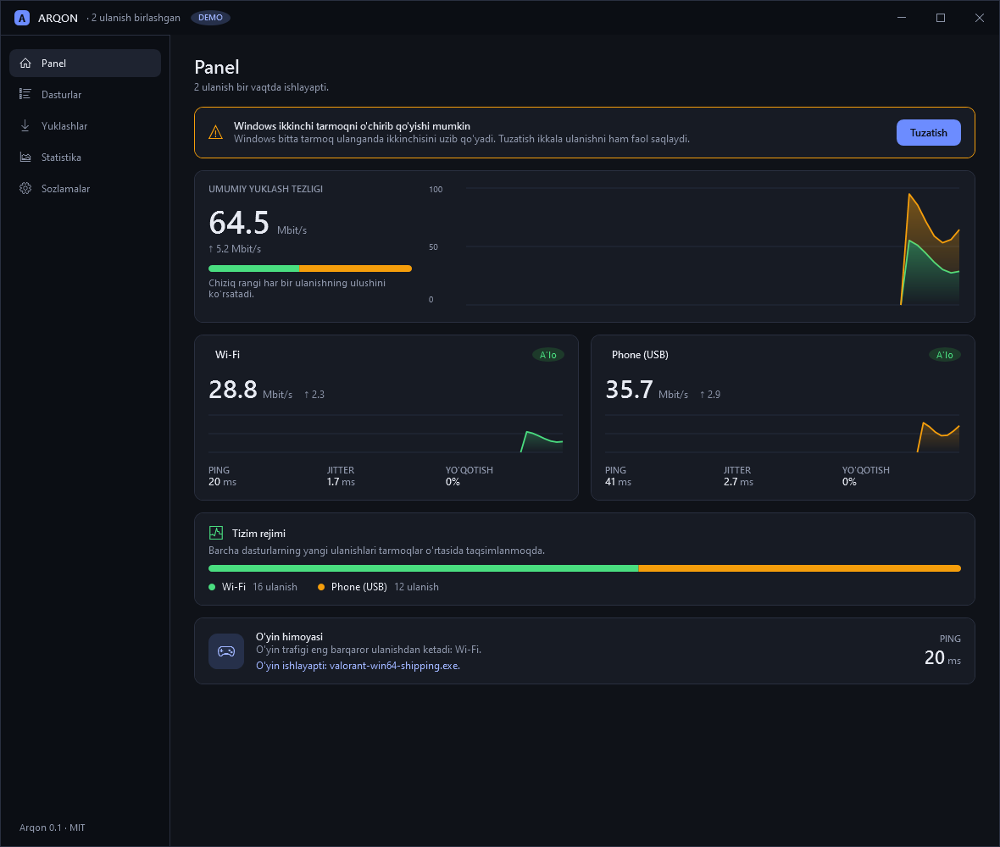
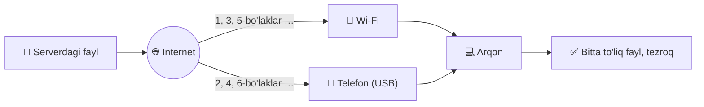
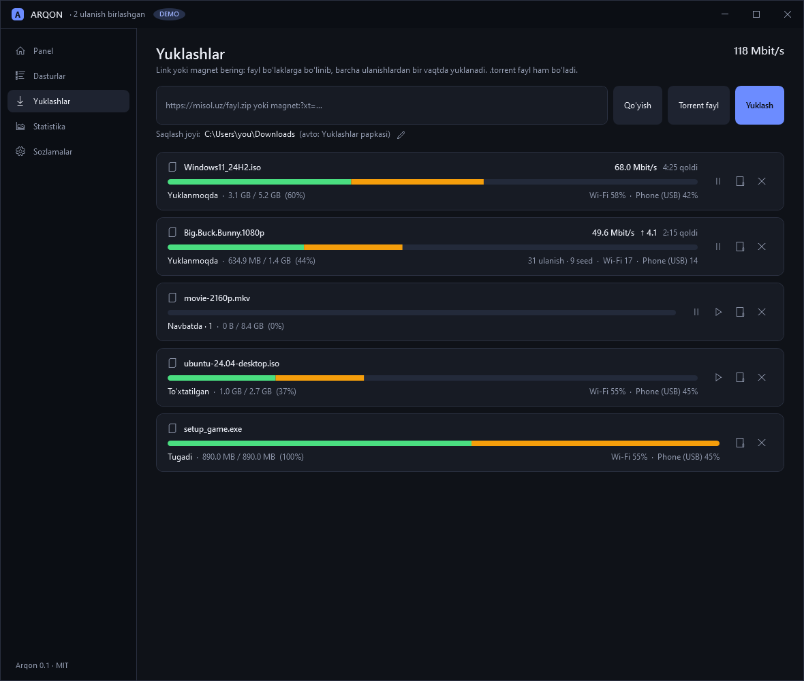
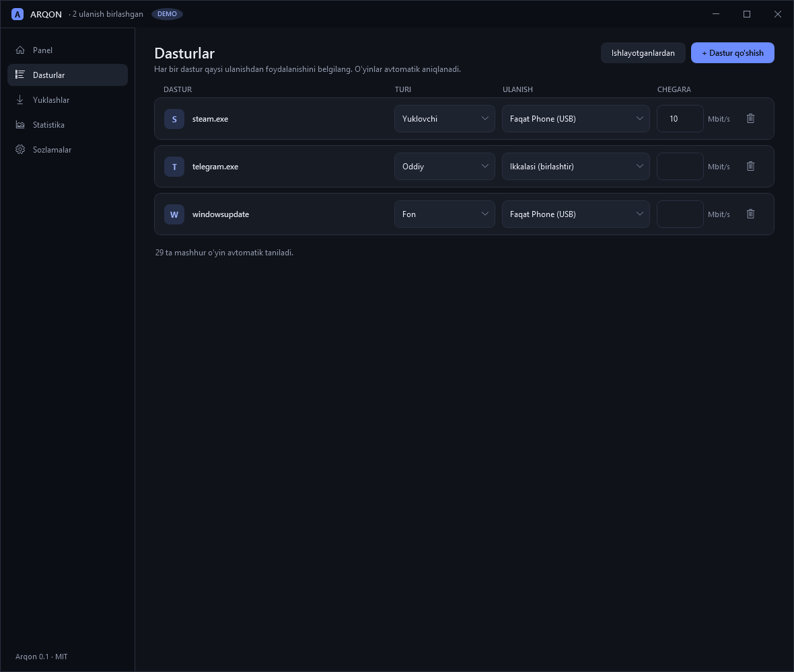
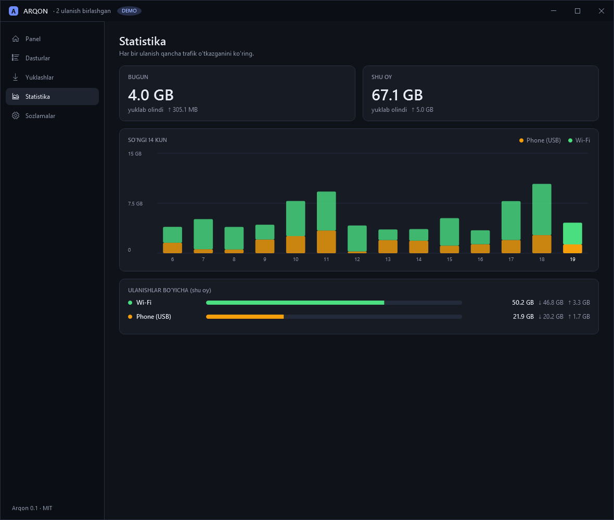

<div align="center">


# Arqon

### Windows'da Wi-Fi + Ethernet + telefon internetini bir vaqtda ishlating.

**⚡ Yuklash tezroq &nbsp;·&nbsp; 🎮 Yuklash paytida o'yin qotmaydi &nbsp;·&nbsp; 🆓 Bepul &nbsp;·&nbsp; 🔓 Ochiq kod**

[](https://github.com/shaxboz1011/Arqon/releases/latest)

[](https://github.com/shaxboz1011/Arqon/actions/workflows/build.yml)
[](https://github.com/shaxboz1011/Arqon/releases/latest)
[](https://github.com/shaxboz1011/Arqon/releases)
[](LICENSE)


**🌐 Til:** [English](README.md) · **O'zbekcha** · [Русский](README.ru.md)

<br>



</div>

<br>

> *Arqon*: bir nechta ingichka ip, bitta mustahkam arqon.

**Sahifada:**
[Nega](#-nega-arqon) ·
[Qanday ishlaydi](#-qanday-ishlaydi) ·
[O'rnatish](#-1-daqiqada-ornatish) ·
[Tanishuv](#-qisqa-tanishuv) ·
[System mode](#-system-mode-hamma-ilova-uchun) ·
[Buyruqlar](#-buyruq-qatori) ·
[Savol-javob](#-savol-javob) ·
[Yig'ish](#-manba-koddan-yigish) ·
[Holat](#-imkoniyatlar-va-holat) ·
[Hissa](#-hissa-qoshish)

---

## 🎯 Nega Arqon

Ko'pchilikda internetga chiqishning bir nechta yo'li bor: uyda Wi-Fi, kabel, telefondagi mobil internet. **Windows esa bir vaqtda faqat bittasini ishlatadi.** Shuning uchun katta fayl sekin yuklanadi, yuklash ketayotganda o'yin esa qotadi.

Arqon **hammasini birga ishlatadi**:

| | Nima olasiz | Isbot |
|---|---|---|
| ⚡ | **Yuklash tezroq.** Fayl bo'laklarga bo'linadi va har bir bo'lak boshqa-boshqa ulanish orqali bir vaqtda yuklanadi. | Wi-Fi + USB telefon bilan 140 MB taxminan **10 soniyada** |
| 🎮 | **O'yin qotmaydi.** Arqon ishlayotgan o'yinni ko'radi, pingni kuzatadi va yuklashni *faqat o'yin ulanishida*, *faqat kerakli darajada* sekinlashtiradi. Keyin tezlikni qaytaradi. | O'yin himoyasi, o'zi tiklanadi |
| 🌍 | **Har qanday ilova foyda ko'radi.** *System mode* Telegram, Chrome, Steam va boshqalarning ulanishlarini barcha ulanishlarga taqsimlaydi. | 40 ta parallel yuklash 11,3 o'rniga **5,3 soniyada** |
| 🧲 | **Torrent ham.** Peer ulanishlari barcha ulanishlarga taqsimlanadi. Magnet link qo'ying yoki `.torrent` oching, kerakli fayllarni tanlang. | Haqiqiy Debian torrenti: ikkala adapter ham ma'lumot tashidi |
| 🔒 | **Yashirin narsa yo'q.** Akkaunt yo'q, reklama yo'q, telemetriya yo'q. | MIT litsenziyasi, kodni o'qing |

> [!IMPORTANT]
> Arqon faqat har bir ulanishning **o'z** internet yo'li bo'lganda tezlik qo'shadi: masalan, bitta routerning Wi-Fi'si va telefonning mobil interneti. *Bitta* router ortidagi ikkita adapter bitta chiziqni bo'lishadi va foyda bermaydi.

## 🧵 Qanday ishlaydi



- **Yuklash va torrent:** Arqon har bir adapterga bog'langan ulanishlar ochadi va bo'laklarni ular orasida bo'lib beradi. Sekin yoki o'lik ulanish boshqalarni to'xtatmaydi.
- **O'yin himoyasi:** o'yin ishlatayotgan ulanishning ping, jitter va yo'qotishini kuzatadi. Ular oshsa, shu ulanishdagi yuklash biroz sekinlashadi; tinchlansa, tezlik pog'ona-pog'ona qaytadi.
- **System mode (ixtiyoriy):** paket drayveri yordamida istalgan dasturning *yangi* ulanishi sizning ulanishlaringizdan biriga beriladi. Boshlangan ulanish hech qachon ko'chirilmaydi, shuning uchun hech narsa uzilmaydi.

## 📸 Skrinshotlar

<div align="center">

| Yuklashlar | Dasturlar | Statistika |
|:---:|:---:|:---:|
|  |  |  |

</div>

<sub>Interfeys **o'zbek, ingliz va rus** tillarida (Sozlamalardan almashtiriladi, darhol o'zgaradi). Skrinshotlar demo rejimda olingan.</sub>

## 🚀 1 daqiqada o'rnatish

1. [Oxirgi relizdan](https://github.com/shaxboz1011/Arqon/releases/latest) **`Arqon.exe`** ni yuklab oling. Bu bitta fayl: o'rnatish shart emas, .NET ichida bor.
2. **Ikki marta bosib oching.**

   > [!NOTE]
   > Windows SmartScreen "noma'lum ilova" deb ogohlantirishi mumkin, chunki fayl hali kod imzosiga ega emas ([Xavfsizlik](#-xavfsizlik)). **More info → Run anyway** ni bosing.

3. **Ikkinchi internetni ulang**, masalan telefonni **USB modem** rejimida.
   *Android: Sozlamalar → Tarmoq → Hotspot va modem → USB modem.*
4. **Panel** (Dashboard) sahifasini oching. Ikkala ulanish ham ko'rinishi kerak. Sariq ogohlantirish chiqsa, **Fix** tugmasini bosing (aks holda Windows ikkinchi tarmoqni o'chirib qo'yishi mumkin).

<details>
<summary><b>🔐 Yuklab olingan faylni tekshirish (ixtiyoriy)</b></summary>

Faylingizning SHA-256 ini relizdagi `Arqon.exe.sha256` bilan solishtiring:

```powershell
(Get-FileHash .\Arqon.exe -Algorithm SHA256).Hash
```

</details>

## 🧭 Qisqa tanishuv

| Sahifa | Nima qilinadi |
|---|---|
| 📊 **Panel** | Har bir ulanishni jonli ko'rish: tezlik, ping, jitter, yo'qotish. Windows ikkinchi tarmoqni o'chirib qo'yishini bir bosishda tuzatish. |
| ⬇️ **Yuklashlar** | Fayl yoki magnet link qo'ying yoki `.torrent` tanlang. Papkani tanlang. Ko'p fayllik torrentda kerakli fayllarni belgilang. |
| 🧩 **Dasturlar** | Dastur uchun qoida: avtomatik, faqat Wi-Fi, faqat telefon, ikkalasi yoki tezlik limiti. O'yinlar o'zi aniqlanadi. |
| 📈 **Statistika** | Har bir ulanish kuniga va oyiga qancha trafik sarflagani (telefon tarifi uchun qulay). |
| ⚙️ **Sozlamalar** | Til, tezlik birligi (Mbit/s yoki MB/s), o'yin himoyasi, system mode, torrentlar, tray, Windows bilan ishga tushish. |

## 🔧 System mode (hamma ilova uchun)

System mode **barcha** dasturlarning yangi ulanishlarini sizning ulanishlaringiz bo'yicha taqsimlaydi. Buning uchun imzolangan [WinDivert](https://reqrypt.org/windivert.html) paket drayveri va **administrator huquqi** kerak, shuning uchun u **standart holatda o'chiq**.

<details>
<summary><b>O'rnatish buyruqlarini ko'rsatish</b></summary>

```powershell
# 1. Yordamchi skriptni yuklab oling (u drayverni o'rnatishdan oldin imzosini tekshiradi)
Invoke-WebRequest https://raw.githubusercontent.com/shaxboz1011/Arqon/main/tools/get-windivert.ps1 -OutFile get-windivert.ps1

# 2. Drayverni Arqon.exe yoniga qo'ying (papkani o'zingizning Arqon.exe joyiga o'zgartiring)
powershell -ExecutionPolicy Bypass -File .\get-windivert.ps1 -Destination "C:\Tools\Arqon"
```

Keyin `Arqon.exe` ni **administrator sifatida** ishga tushiring va Sozlamalarda *System mode* ni yoqing.

</details>

> [!TIP]
> Xato bo'lsa, Windows darhol odatdagidek yo'naltirishga qaytadi. Katalogdagi o'yin ishlayotganda Arqon system mode'ni o'chiradi va drayverni xotiradan chiqaradi (anti-cheat xavfsizligi uchun). Batafsil: [docs/steering.md](docs/steering.md).

## 🧰 Buyruq qatori

Hammasi oynada bor, lekin quyidagi buyruqlar ham mavjud:

| Buyruq | Nima qiladi |
|---|---|
| `Arqon.exe` | Oddiy ishga tushirish. |
| `Arqon.exe "C:\yo'l\fayl.torrent"` | Torrent faylni qo'shadi (`.torrent` ustiga ikki marta bosganda shu ishlaydi). |
| `Arqon.exe "magnet:?xt=urn:btih:..."` | Magnet linkni qo'shadi. Ishlab turgan Arqon uni o'zi qabul qiladi. |
| `Arqon.exe --tray` | Tray'da yashirin ishga tushadi (*Windows bilan ishga tushish* shuni ishlatadi). |
| `Arqon.exe --demo` | Ikkita soxta ulanish, telefon shart emas. Interfeysni sinash uchun qulay. |
| `Arqon.exe --screenshots <papka>` | Har bir sahifaning rasmini papkaga saqlaydi. |

Sozlamalardagi **Torrent va magnet linklarni Arqon bilan ochish** tugmasi uni `.torrent` fayllar va `magnet:` linklar uchun ro'yxatdan o'tkazadi (faqat joriy foydalanuvchi uchun, administrator huquqisiz, boshqa dasturning tanlovini hech qachon tortib olmaydi).

## ❓ Savol-javob

<details>
<summary><b>Telefon shartmi?</b></summary>

Yo'q. O'z internet yo'li bor har qanday ikki (yoki undan ko'p) ulanish ishlaydi: bir routerning Wi-Fi'si va boshqasining kabeli, telefon va hokazo. USB modem rejimidagi telefon shunchaki eng oson ikkinchi yo'l.

</details>

<details>
<summary><b>Mobil internetim tez tugab qolmaydimi?</b></summary>

Telefon orqali o'tgan hamma narsa mobil tarifingizdan hisoblanadi, shuning uchun cheksiz tarif bilan eng yaxshi ishlaydi. **Statistika** sahifasi har bir ulanish qancha sarflaganini ko'rsatadi, **Dasturlar** sahifasida esa dasturni faqat Wi-Fi'ga bog'lash yoki tezlik limiti qo'yish mumkin.

</details>

<details>
<summary><b>Onlayn o'yinlar bilan ishlatish xavfsizmi?</b></summary>

O'yin himoyasi faqat *yuklashni sekinlashtiradi*, o'yinga tegmaydi. System mode tarmoq drayverini yuklaydi, ba'zi anti-cheat dasturlar buni yoqtirmaydi. Shuning uchun **Xavfsiz o'yin rejimi** (standart yoqilgan) o'yin paytida system mode'ni o'chiradi va drayverni chiqaradi. U soxta o'yin bilan sinalgan, **haqiqiy anti-cheat bilan hali emas**. VAC himoyasidagi o'yinlarda ehtiyot bo'lish uchun system mode'ni o'chiq qoldiring.

</details>

<details>
<summary><b>System mode nega administrator huquqini so'raydi?</b></summary>

Faqat system mode so'raydi, chunki u paket drayverini yuklaydi. Yuklash, torrent, o'yin himoyasi va qolgan hamma narsa administrator huquqisiz ishlaydi.

</details>

<details>
<summary><b>Windows 7, Linux yoki macOS'da ishlaydimi?</b></summary>

Yo'q. Arqon Windows 10 va 11 (64-bit) uchun.

</details>

<details>
<summary><b>Qanday o'chiraman?</b></summary>

Sozlamalarda *Windows bilan ishga tushish* va *Torrent va magnet linklarni Arqon bilan ochish* ni o'chiring, Arqon'ni yoping va `Arqon.exe` ni o'chirib tashlang. Ma'lumotlari (sozlamalar, yuklashlar ro'yxati) `%APPDATA%\Arqon` papkasida, xohlasangiz uni ham o'chiring. System mode uchun WinDivert o'rnatgan bo'lsangiz, exe yonidagi `WinDivert.dll` va `WinDivert64.sys` ni o'chiring.

</details>

## 📦 Manba koddan yig'ish

Windows 10/11 va [.NET 10 SDK](https://dotnet.microsoft.com/download) kerak.

```powershell
git clone https://github.com/shaxboz1011/Arqon.git
cd Arqon

dotnet run --project src/Arqon.App            # haqiqiy adapterlar bilan ishga tushirish
dotnet run --project src/Arqon.App -- --demo  # ikkita soxta ulanish bilan
dotnet test                                    # 402 ta test

# bitta mustaqil Arqon.exe (taxminan 75 MB) publish\win-x64 papkasida
powershell -ExecutionPolicy Bypass -File tools\build.ps1
```

## 📋 Imkoniyatlar va holat

| Imkoniyat | Holat |
|---|---|
| Ulanishlarni topish (Wi-Fi / Ethernet / telefon) va jonli monitor: tezlik, ping, jitter, yo'qotish | ✅ Tayyor |
| Ko'p ulanishli yuklovchi: har bir ulanish orqali HTTP bo'laklar, davom ettirish, tezlik limiti, 429 / Retry-After'ni hurmat qilish | ✅ Tayyor |
| Yuklash navbati (bir vaqtda ko'pi bilan N ta, "Hozir boshlash") | ✅ Tayyor |
| O'yin ping himoyasi: yuklashni faqat o'yin ulanishida cheklaydi, keyin tezlikni sekin qaytaradi | ✅ Tayyor |
| Dastur qoidalari, o'yinlar katalogi, JSON sozlamalar | ✅ Tayyor |
| Windows ikkinchi tarmoqni o'chirib qo'yishini bir bosishda tuzatish | ✅ Tayyor |
| Har bir ulanish bo'yicha kunlik va oylik statistika | ✅ Tayyor |
| Tray, bildirishnomalar, buferdagi linkni taklif qilish, bitta nusxa, Windows bilan ishga tushish | ✅ Tayyor |
| Vazifalar panelida tezlik o'lchagichi | ✅ Tayyor (Windows 10, pastdagi panelda sinalgan) |
| Xavfsiz o'yin rejimi (o'yin paytida system mode o'chadi, drayver chiqariladi) | ✅ Tayyor (soxta o'yin bilan sinalgan, haqiqiy anti-cheat bilan emas) |
| Tezlik birligi (Mbit/s yoki MB/s) | ✅ Tayyor |
| Interfeys o'zbek, ingliz va rus tilida | ✅ Tayyor (boshqa tillar xush kelibsiz) |
| Torrent va magnet linklar barcha ulanishlar bo'yicha; papka tanlash; fayl tanlash; nisbat bilan ixtiyoriy tarqatish (seeding), qayta ochilgandan keyin ham; Windows'dan ochish | ✅ Tayyor (haqiqiy Debian torrenti Wi-Fi + telefon bilan) |
| **System mode** (Telegram, Chrome va hamma ilovani tezlatish) | 🧪 Birinchi haqiqiy sinovda ishladi (Wi-Fi + USB telefon). O'yin bilan va uzoq sessiyada hali sinalmagan |
| Relay server (bitta ulanishni bo'laklash, o'yin paketlarini nusxalash) | 🗓 Rejada |
| O'rnatuvchi va kod imzosi | 🗓 Rejada |

**Ochiq cheklovlar:** tarqatish (seeding) ixtiyoriy (standart o'chiq) va qayta ochilgandan keyin faqat fayllar diskda turgan bo'lsa davom etadi, UPnP port ochish o'chiq, bitta faylli `Arqon.exe` dan system mode drayver bilan hali tekshirilmagan.

## 🔒 Xavfsizlik

- **Telemetriya yo'q, akkaunt yo'q, yangilanish so'rovlari yo'q.** Arqon faqat siz so'raganga ulanadi. Qo'shimcha: ulanish monitori ping o'lchash uchun `1.1.1.1` / `8.8.8.8` (443-port) ga ulanadi, torrentlar esa har qanday torrent klient kabi ochiq trackerlar va DHT bilan bog'lanadi.
- Windows'ga o'zgartirish (registr, drayver) avval tushuntiriladi va qaytariladi. System mode standart holatda o'chiq va xato bo'lsa o'zi o'chadi.
- `Arqon.exe` hozircha **kod imzosiz**, shuning uchun SmartScreen ogohlantiradi. SHA-256 ni tekshiring yoki shu manba koddan o'zingiz yig'ing. Ochiq kodli loyihalar uchun bepul imzolash rejada.
- Zaiflik topdingizmi? [SECURITY.md](SECURITY.md) ni o'qing.

## 🤝 Hissa qo'shish

Xato haqida xabar, g'oya, tarjima va pull request'lar xush kelibsiz. [CONTRIBUTING.md](CONTRIBUTING.md) dan boshlang.

- 🧪 **O'zingizning ikki ulanishingizda sinab ko'ring** va natijani yozing: [sinov natijasini yuborish](https://github.com/shaxboz1011/Arqon/issues/new/choose).
- 🌐 Interfeysga **til qo'shing**: `src/Arqon.App/Resources/Strings.en.xaml` ni nusxalab tarjima qiling, test hech narsa tushib qolmaganini tekshiradi.
- 🐛 [Issue](https://github.com/shaxboz1011/Arqon/issues/new/choose) orqali xato haqida xabar bering yoki g'oya taklif qiling.

Arqon sizga foydali bo'lsa, GitHub'dagi ⭐ boshqalarga uni topishga yordam beradi.

## 📄 Litsenziya

MIT, [LICENSE](LICENSE) ga qarang. System mode [WinDivert](https://github.com/basil00/WinDivert) (LGPLv3) dan foydalanadi; u alohida yuklanadi va bu repozitoriyga kirmaydi. Torrentlar uchun [MonoTorrent](https://github.com/alanmcgovern/monotorrent) (MIT) ishlatiladi.
