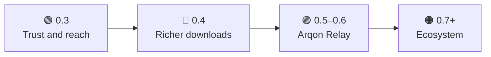

# Roadmap

**🌐 Language:** **English** · [O'zbekcha](ROADMAP.uz.md)

Where Arqon goes next. This is a plan, not a promise: dates are rough and the order can change after test reports. Ideas and help are welcome in [issues](https://github.com/shaxboz1011/Arqon/issues/new/choose).

## 🟢 0.3: Trust and reach (first)

New features do not help if people cannot install Arqon without warnings.

| Item | Why |
|---|---|
| **Code signing** (for example SignPath, free for open-source projects) | SmartScreen stops warning; people trust the file |
| **Installer, `winget` and Scoop** | `winget install Arqon`; updates are cleaner than replacing a single exe |
| **Android 1.0 release** (the `android-release.yml` workflow is ready) | First APK on GitHub Releases, then F-Droid |
| **System mode stress tests**: long sessions, the single-file `Arqon.exe`, real games with anti-cheat (VAC, EAC) | Closes the open points in *Features and status* |
| Local crash log and a *Copy report* button on Windows (Android has one) | Better bug reports |

## 🔵 0.4: Richer downloads

| Item | Notes |
|---|---|
| **Browser extension** (Chrome, Firefox) that hands downloads to Arqon | `ExternalRequests` already accepts links from outside; the extension is the bridge |
| **Video downloads** (yt-dlp, HLS / DASH segments) | Segments spread over links naturally, so the gain is large |
| **Schedule** ("download at night", "only on Wi-Fi") | Saves mobile data |
| **Link cost / weight** ("phone data is expensive, use it last") | Fits into `RuleEngine` and `LinkScorer` |
| Torrents: UPnP port mapping, RSS feeds, sequential (streaming) download | Closes the *Honest limits* in the README |

## 🟣 0.5–0.6: Arqon Relay (the big step)

One TCP connection cannot be split across two links without something on the other side ([docs/steering.md](docs/steering.md)). The relay is that something.

- A **self-hosted relay server** (Docker, one command on a VPS). A tunnel (QUIC or WireGuard based) carries packets over every link.
- **Duplicated game packets**: the game's packets go over two links, so one link dropping a packet does not cause lag.
- Single-connection traffic (one big file, YouTube, video calls) gets faster too.
- Stays optional: everything that works today keeps working without a server.

## 🟠 0.7+: Ecosystem

- **Phone ↔ PC**: the Android app sets up the phone as the PC's second link by itself (USB or Wi-Fi) and usage is shown in one place.
- **Linux and macOS**: `Arqon.Core` targets plain `net10.0`, so much of it is portable; the UI could move to Avalonia.
- **OpenWrt package**: combine links on the router for the whole home.
- **Local API / CLI**: scripts and other programs can add downloads and read link status.

## ⚪ Always

- More interface languages: Kazakh, Kyrgyz, Tajik, Turkish, Persian.
- A page of real results per provider combination (for example Uzmobile, Beeline, Ucell, Mobiuz), collected from [test reports](https://github.com/shaxboz1011/Arqon/issues/new/choose).
- A small website (GitHub Pages), a Telegram channel, GitHub Sponsors.
