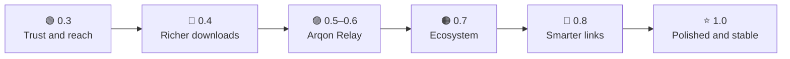

# Roadmap

**🌐 Language:** **English** · [O'zbekcha](ROADMAP.uz.md)

Where Arqon goes next. This is a plan, not a promise: the order can change after test reports. Ideas and help are welcome in [issues](https://github.com/shaxboz1011/Arqon/issues/new/choose).

**Legend:** ✅ done · 🧪 done, needs real-world testing · 🔑 needs the owner (an account, a secret or hardware) · 🗓 planned

## 🟢 0.3: Trust and reach

New features do not help if people cannot install Arqon without warnings.

| Item | Status |
|---|---|
| Crash log for every unhandled error (UI, background threads, tasks), trimmed automatically | ✅ |
| *Settings → Problem report → Copy report*: version, Windows, connections, system mode, last crashes, with the user name, full addresses and folders left out | ✅ |
| winget manifests written for every release; automatic submission to winget-pkgs once the `WINGET_TOKEN` secret exists ([docs/winget.md](docs/winget.md)) | ✅ / 🔑 token |
| Code signing (SignPath, free for open-source projects): apply, then sign `Arqon.exe` in `release.yml` | 🔑 |
| Android 1.0 release: the `android-release.yml` workflow is ready, it needs the signing key secrets | 🔑 |
| System mode stress tests: long sessions, the single-file exe, real games with anti-cheat (VAC, EAC) | 🔑 hardware |
| Scoop bucket and a Microsoft Store (MSIX) package | 🗓 |

## 🔵 0.4: Richer downloads

| Item | Status |
|---|---|
| **Browser extension** for Chrome, Edge and Firefox: *Download with Arqon* on every link, and optionally every download ([browser-extension/](browser-extension/README.md)) | 🧪 |
| `arqon://add?url=…` links: the browser, a bookmarklet or a script can hand a link to Arqon (web and magnet links only) | ✅ |
| **Download schedule**: queued downloads start only in chosen hours (a cheaper night plan) | ✅ |
| **Save data on chosen connections**: downloads and torrents use them only as the last link; optionally all phone links once the daily limit is reached | ✅ |
| Torrents: UPnP / NAT-PMP port mapping as an option (off by default) | ✅ |
| Publish the extension in the Chrome Web Store and on addons.mozilla.org | 🔑 |
| Video downloads (yt-dlp, HLS / DASH segments spread over the links) | 🗓 |
| Same file from several mirrors at once (Metalink, a list of mirror links) | 🗓 |
| Check a finished download against a SHA-256 the user pastes or the page gives | 🗓 |
| Torrents: RSS feeds, sequential download for watching while it downloads | 🗓 |

## 🟣 0.5–0.6: Arqon Relay (the big step)

One TCP connection cannot use two links without something on the other side. The relay is that something. Design: [docs/relay.md](docs/relay.md).

| Item | Status |
|---|---|
| Protocol groundwork: signed frames (HMAC-SHA256), reorder buffer that drops duplicates and skips lost frames, link scheduler by expected arrival time | ✅ |
| Self-hosted relay server (Docker, one command on a VPS) | 🗓 |
| Tunnel client on Windows (Wintun or the existing WinDivert steering), one UDP socket per link | 🗓 |
| Pairing with a QR code or a link; key exchange; ChaCha20-Poly1305 encryption inside the tunnel | 🗓 |
| Duplicated game packets: a link that drops a packet does not cause lag | 🗓 |
| Congestion control per link (rate-based, no full buffers); moving traffic off a link whose ping rises | 🗓 |
| Speed test with and without the relay, honest about the extra hop | 🗓 |

## 🟠 0.7: Ecosystem

| Item | Status |
|---|---|
| **Local API** on 127.0.0.1 with a token: read connections and downloads, add a download ([docs/api.md](docs/api.md)) | ✅ |
| Command line: `Arqon.exe "<link>"` hands web, magnet, torrent and `arqon://` links to the running copy | ✅ |
| Phone ↔ PC: the Android app sets the phone up as the PC's second link by itself (USB or Wi-Fi), usage in one place | 🗓 |
| Linux and macOS: most of `Arqon.Core` is plain .NET; the Windows-only parts (registry, WinDivert) sit behind interfaces; the UI could move to Avalonia | 🗓 |
| OpenWrt package: combine links on the router for the whole home | 🗓 |
| Home Assistant / Prometheus endpoint built on the local API | 🗓 |

## 🔴 0.8: Smarter links

| Item | Why |
|---|---|
| **DNS over every link at once**: the first answer wins | Pages start loading faster, and a dead link does not stall name lookups |
| **Happy eyeballs across links**: a new connection tries the best two links and keeps the one that answers first | Fewer slow starts |
| **Learn each link's quality by time of day** (the phone is fast at night, slow in the evening) and weigh the links by it | Better use without settings |
| **Network doctor**: captive portal, broken DNS, wrong MTU, the Windows "second network switched off" policy, all in one check with a fix button | Fewer support questions |
| Notices with numbers: "the phone carried 2.1 GB today, 38% of all traffic" | People see what they gain |

## ⭐ 1.0: Polished and stable

- A light theme, high-contrast support, full keyboard use and screen-reader names.
- Stable and beta update channels.
- An installer (MSIX or Inno Setup) next to the portable exe.
- A documentation website (GitHub Pages) with guides per phone brand and provider.
- No known crash in the problem reports for a month.

## ⚪ Always

- More interface languages: Kazakh, Kyrgyz, Tajik, Turkish, Persian (a hosted translation tool such as Weblate would make this easy).
- A page of real results per provider combination (for example Uzmobile, Beeline, Ucell, Mobiuz), collected from [test reports](https://github.com/shaxboz1011/Arqon/issues/new/choose).
- "Good first issue" labels and a short architecture guide for new contributors.
- A Telegram channel, GitHub Sponsors.
