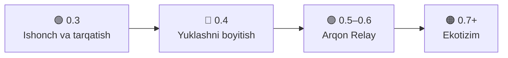

# Yo'l xaritasi (Roadmap)

**🌐 Til:** [English](ROADMAP.md) · **O'zbekcha**

Arqon keyin qayerga boradi. Bu reja, va'da emas: muddatlar taxminiy, sinov natijalariga qarab tartib o'zgarishi mumkin. G'oya va yordamni [issue](https://github.com/shaxboz1011/Arqon/issues/new/choose) orqali yuboring.

## 🟢 0.3: Ishonch va tarqatish (birinchi navbatda)

Odamlar Arqonni ogohlantirishlarsiz o'rnata olmasa, yangi funksiyalar foyda bermaydi.

| Ish | Nega kerak |
|---|---|
| **Kod imzosi** (masalan SignPath, ochiq loyihalar uchun bepul) | SmartScreen ogohlantirmaydi, faylga ishonch oshadi |
| **O'rnatuvchi, `winget` va Scoop** | `winget install Arqon`; yangilanish bitta exe ni almashtirishdan tozaroq |
| **Android 1.0 reliz** (`android-release.yml` tayyor) | GitHub Releases'da birinchi APK, keyin F-Droid |
| **System mode stress-testlari**: uzoq sessiya, bitta faylli `Arqon.exe`, anti-cheatli haqiqiy o'yinlar (VAC, EAC) | *Funksiyalar va holat* dagi ochiq nuqtalarni yopadi |
| Windows'da mahalliy crash log va *Hisobotni nusxalash* tugmasi (Androidda bor) | Sifatliroq bug report |

## 🔵 0.4: Yuklashni boyitish

| Ish | Izoh |
|---|---|
| **Brauzer kengaytmasi** (Chrome, Firefox): yuklashlarni Arqonga beradi | `ExternalRequests` tashqaridan link qabul qiladi; kengaytma shunchaki ko'prik |
| **Video yuklash** (yt-dlp, HLS / DASH segmentlar) | Segmentlar ulanishlarga tabiiy bo'linadi, foyda katta |
| **Rejalashtirish** ("tunda yukla", "faqat Wi-Fi'da") | Mobil trafikni tejaydi |
| **Ulanish narxi / vazni** ("telefon trafigi qimmat, oxirida ishlat") | `RuleEngine` va `LinkScorer` ga qo'shiladi |
| Torrent: UPnP port ochish, RSS, ketma-ket (streaming) yuklash | README'dagi *Ochiq cheklovlar* ni yopadi |

## 🟣 0.5–0.6: Arqon Relay (katta qadam)

Bitta TCP ulanishni narigi tomonda biror narsa bo'lmasa ikki ulanishga bo'lib bo'lmaydi ([docs/steering.md](docs/steering.md)). Relay o'sha narsa.

- **O'zingiz joylashtiradigan relay server** (Docker, VPS'da bitta buyruq). Tunnel (QUIC yoki WireGuard asosida) paketlarni hamma ulanishlar orqali olib boradi.
- **O'yin paketlarini nusxalash**: o'yin paketlari ikki ulanishdan ketadi, bittasi paketni yo'qotsa ham lag bo'lmaydi.
- Bitta ulanishli trafik (bitta katta fayl, YouTube, video qo'ng'iroq) ham tezlashadi.
- Ixtiyoriy bo'lib qoladi: bugun ishlayotgan hamma narsa serversiz ham ishlayveradi.

## 🟠 0.7+: Ekotizim

- **Telefon ↔ kompyuter**: Android ilova telefonni kompyuterning ikkinchi ulanishi qilib o'zi sozlaydi (USB yoki Wi-Fi), sarf bitta joyda ko'rinadi.
- **Linux va macOS**: `Arqon.Core` oddiy `net10.0` da, ko'p qismi ko'chiriladi; interfeys Avalonia'ga o'tishi mumkin.
- **OpenWrt paketi**: butun uy uchun ulanishlarni routerda birlashtirish.
- **Mahalliy API / CLI**: skriptlar va boshqa dasturlar yuklash qo'sha oladi va ulanishlar holatini o'qiy oladi.

## ⚪ Doimiy

- Yangi interfeys tillari: qozoq, qirg'iz, tojik, turk, fors.
- Operatorlar juftligi bo'yicha haqiqiy natijalar sahifasi (masalan Uzmobile, Beeline, Ucell, Mobiuz), [sinov hisobotlari](https://github.com/shaxboz1011/Arqon/issues/new/choose) dan yig'iladi.
- Kichik sayt (GitHub Pages), Telegram kanal, GitHub Sponsors.
