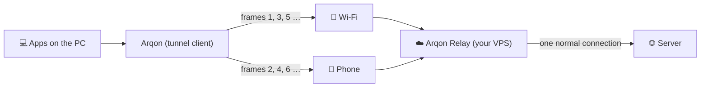

# Arqon Relay (design, in progress)

Without help from the other side, one TCP connection cannot use two links: the server sees one address, and the packets of a connection must come from it. Downloads get around this with many connections, one per piece. Everything else (a single big transfer, a video stream, a video call, a game) stays on one link. The relay is the "other side" that lifts this limit.

## What exists now

The building blocks in [`src/Arqon.Core/Relay`](../src/Arqon.Core/Relay), with tests:

| Piece | What it does |
|---|---|
| `RelayCodec` | Frames: version, type, link index, session, 64-bit sequence number, payload (up to 1400 bytes, one UDP datagram), and a 16-byte HMAC-SHA256 tag. A frame with a wrong tag is dropped, so nobody who finds the relay's port can inject data. |
| `ReorderBuffer` | Frames arrive over several links out of order, and game packets arrive twice. It hands them on in order and exactly once. It waits for a missing frame only for a short time, then skips it, because a stuck stream is worse than a lost packet (TCP inside the tunnel resends it). |
| `LinkScheduler` | Sends each frame on the link that would deliver it first, counting the link's delay and what is already queued on it. A fast link carries more, and a slow one still helps without holding the stream back. Game packets go out on every link. |

## What is still missing

1. **The tunnel client**: a virtual network adapter (Wintun, the driver WireGuard uses) or the existing WinDivert steering, so that chosen apps (or all of them) go into the tunnel. One UDP socket per link, bound to that link's address, as the downloader already does.
2. **The relay server**: a small program for Linux (one Docker command on a VPS). It accepts the links of a session, puts the frames back in order, and sends the traffic out as one normal connection (NAT), then splits the answers back over the links.
3. **Key exchange**: the session key is made when the client is paired with the server (a QR code or a pasted link holding the server's address and a one-time secret), and not sent in the clear afterwards. Inside the tunnel, the payload is encrypted as well (ChaCha20-Poly1305), not only signed.
4. **Congestion control** per link (BBR-like: measure the rate, do not fill the buffers), and moving traffic away from a link whose ping rises, as the game guard does today.
5. **Real tests** with two live links and a real VPS, including a long session and a game.

## Principles

- **Optional.** Arqon keeps working without a relay, exactly as now.
- **Your own server.** No Arqon cloud and no accounts; the server is open source like the app.
- **Fails open.** If the relay cannot be reached, traffic goes out directly within two seconds, as with system mode today.
- **Honest numbers.** The relay costs one extra hop (the ping to the VPS) and the VPS's own bandwidth, and the speed test will show both.
